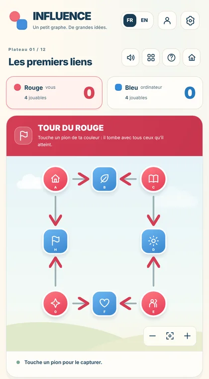

::: {.apps-intro}
Cette page rassemble les petits programmes que je construis à côté de mes recherches et de mes cours. On y trouve d'abord des applications qui viennent directement de mes articles ou de mon enseignement : l'occasion de jouer avec les objets dont on parle d'habitude au tableau. On y trouve ensuite des applications pédagogiques, de la maternelle à la terminale, que j'ai surtout développées pour mes enfants. Elles servent d'abord de terrain d'essai à la maison ; je les laisse en accès libre au cas où elles serviraient à d'autres. Tout s'ouvre dans un navigateur, sans installation.
:::

```{=html}
<h2 class="apps-section-title" id="recherche">Issu de mes recherches</h2>
<p class="apps-section-sub">Des jeux et des outils tirés de mes articles et de mes cours.</p>

<div class="apps-wrap">
<section class="apps-hero" id="influence" aria-labelledby="influence-title">
  <div class="apps-hero-text">
    <p class="apps-kicker">Jeu à deux sur un graphe · FR / EN</p>
    <h2 id="influence-title"><span class="apps-dots" aria-hidden="true"><i></i><i></i></span>INFLUENCE <small>le jeu des connexions</small></h2>
    <p>INFLUENCE est tiré de l'article que nous avons écrit avec Éric Duchêne, Aline Parreau, Éric Rémila et Philippe Solal. Deux joueurs, un graphe orienté dont les sommets sont rouges ou bleus. À son tour, on choisit un sommet de sa couleur et on capture tout ce qu'il atteint en suivant les arcs (pour le joueur bleu, ils sont lus à l'envers). Chaque sommet capturé vaut un point, et le coup le plus gourmand n'est pas toujours le bon.</p>
    <p>Douze plateaux, à jouer contre l'ordinateur (trois niveaux) ou à deux sur le même écran. Un prénom suffit pour garder sa progression, sur l'appareil ou en ligne avec un code.</p>
    <p class="apps-en" lang="en">INFLUENCE is a two-player scoring game on directed graphs, from our paper in <em>Theoretical Computer Science</em> (2021). You can play it right here, in English or in French.</p>
    <p class="apps-actions">
      <button type="button" class="apps-btn apps-btn-primary" data-influence-play>▶ Jouer ici</button>
      <a class="apps-btn" href="apps/influence/index.html" target="_blank" rel="noopener">Plein écran ↗</a>
      <a class="apps-link" href="https://doi.org/10.1016/j.tcs.2021.05.028">L'article (Theoretical Computer Science, 2021)</a>
    </p>
  </div>
  <div class="apps-stage">
    <div class="apps-phone" id="influence-player">
      <button type="button" class="apps-poster" data-influence-play aria-label="Jouer à INFLUENCE ici, dans la page">
        
        <span class="apps-play">▶ Jouer</span>
      </button>
    </div>
  </div>
</section>
</div>

<h2 class="apps-section-title" id="pedagogiques">Applications pédagogiques</h2>
<p class="apps-section-sub">De la maternelle à la terminale, développées surtout pour mes enfants.</p>

<div class="apps-grid">
  <article class="apps-card" style="--a1:#d4eef4;--a2:#f6c8de">
    <div class="apps-card-art" aria-hidden="true">🧚</div>
    <div class="apps-card-body">
      <h3>Les Gardiens de la Forêt Enchantée</h3>
      <p class="apps-meta">Grande section de maternelle → début du CP · en français</p>
      <p>Une sorcière a plongé la forêt dans l'ombre : l'enfant libère les animaux en relevant des défis de lecture, de nombres et de logique. Une fée lit toutes les consignes à voix haute.</p>
      <details>
        <summary>En savoir plus</summary>
        <p>Lettres sous toutes leurs formes (capitales, minuscules, attachées), sons et syllabes, premiers mots et phrases, dénombrement jusqu'à 20, formes, repérage dans l'espace, longueurs et masses, petits problèmes, et énigmes de logique (fioles à trier, chemins qui passent une seule fois par chaque fleur, suites, sudokus en images). Un espace parents montre ce qui est acquis.</p>
      </details>
      <p class="apps-actions"><a class="apps-btn apps-btn-primary" href="apps/foret-enchantee/index.html">Jouer</a></p>
    </div>
  </article>

  <article class="apps-card" style="--a1:#191c34;--a2:#35396b;--ink:#f1cf8a">
    <div class="apps-card-art" aria-hidden="true">✦</div>
    <div class="apps-card-body">
      <h3>L'École de magie du Fil d'Or</h3>
      <p class="apps-meta">CM2 · en français</p>
      <p>Une apprentie magicienne parcourt une carte du monde : lecture et écriture, calcul et problèmes, fractions et géométrie, jeux de logique. Une histoire en douze chapitres se dévoile au fil des progrès.</p>
      <details>
        <summary>En savoir plus</summary>
        <p>Le Château des Récits (lecture, vocabulaire, grammaire, écriture), les Forges des Nombres (numération, calcul, problèmes), l'Observatoire céleste (fractions, mesures, géométrie) et le Jardin des énigmes (jeux de logique). Chaque lieu s'illumine quand un apprentissage est confirmé sur plusieurs jours, et des défis plus difficiles attendent ceux qui reviennent. Progression enregistrée en ligne avec un nom de magicienne et un petit code ; espace parents avec suivi détaillé.</p>
      </details>
      <p class="apps-actions"><a class="apps-btn apps-btn-primary" href="apps/fil-or/index.html">Jouer</a></p>
    </div>
  </article>

  <article class="apps-card" style="--a1:#07060a;--a2:#4a1424;--ink:#d9b26a">
    <div class="apps-card-art" aria-hidden="true">☾</div>
    <div class="apps-card-body">
      <h3>Codex Umbra <em>prototype</em></h3>
      <p class="apps-meta">Seconde → prépa · 15–25 ans · en français</p>
      <p>Un jeu de dark fantasy : le Codex qui tenait le monde par ses Lois a été déchiré, et chaque notion comprise se réécrit dans le Codex et rallume une partie du monde. Prérequis : le programme de troisième.</p>
      <details>
        <summary>En savoir plus</summary>
        <p>Cinq régions reliées par un graphe de prérequis : les vecteurs, le calcul littéral et la factorisation, le second degré, Python et la logique (chevaliers et fripons, invariants). Trois rangs par Loi, des exercices générés et corrigés exactement (y compris la forme factorisée ou canonique), des démonstrations à reconstituer ou à corriger, une baliste qui suit la parabole qu'on lui donne, et un gardien à vaincre par région.</p>
      </details>
      <p class="apps-actions"><a class="apps-btn apps-btn-primary" href="apps/codex-umbra/index.html">Jouer</a></p>
    </div>
  </article>
</div>

<p class="apps-note">Sur iPad ou tablette : ouvrir l'application dans Safari, puis Partager → « Sur l'écran d'accueil » pour l'installer comme une application.</p>

<script>
(function () {
  var box = document.getElementById('influence-player');
  if (!box) return;
  function start() {
    var frame = box.querySelector('iframe');
    if (!frame) {
      frame = document.createElement('iframe');
      frame.src = 'apps/influence/index.html';
      frame.title = 'INFLUENCE, le jeu des connexions';
      frame.setAttribute('allow', 'fullscreen');
      box.replaceChildren(frame);
    }
    box.scrollIntoView({ block: 'nearest', behavior: 'smooth' });
    frame.focus();
  }
  document.querySelectorAll('[data-influence-play]').forEach(function (b) { b.addEventListener('click', start); });
  if (/[?&]jouer(=|&|$)/.test(location.search) || location.hash === '#jouer') start();
})();
</script>
```
